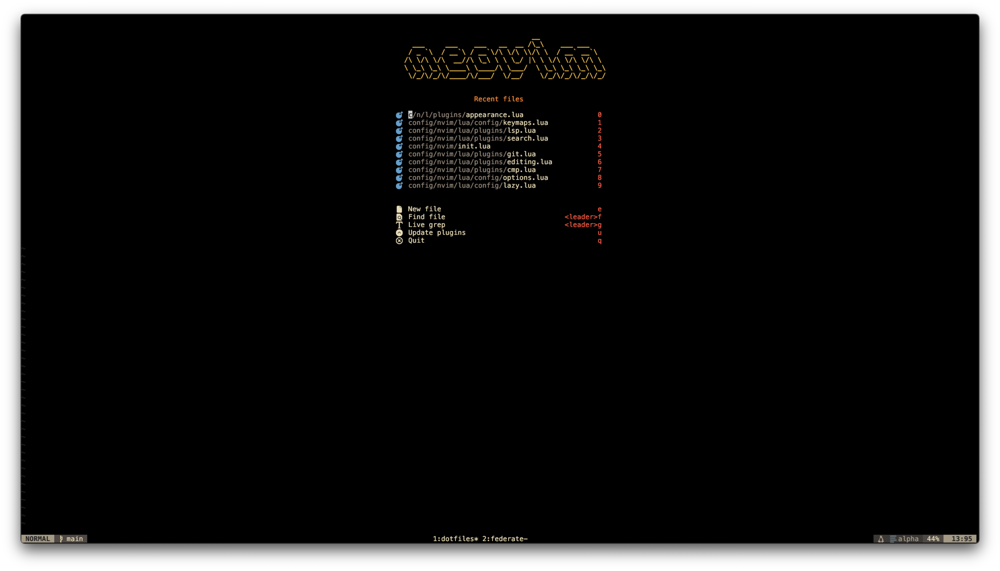
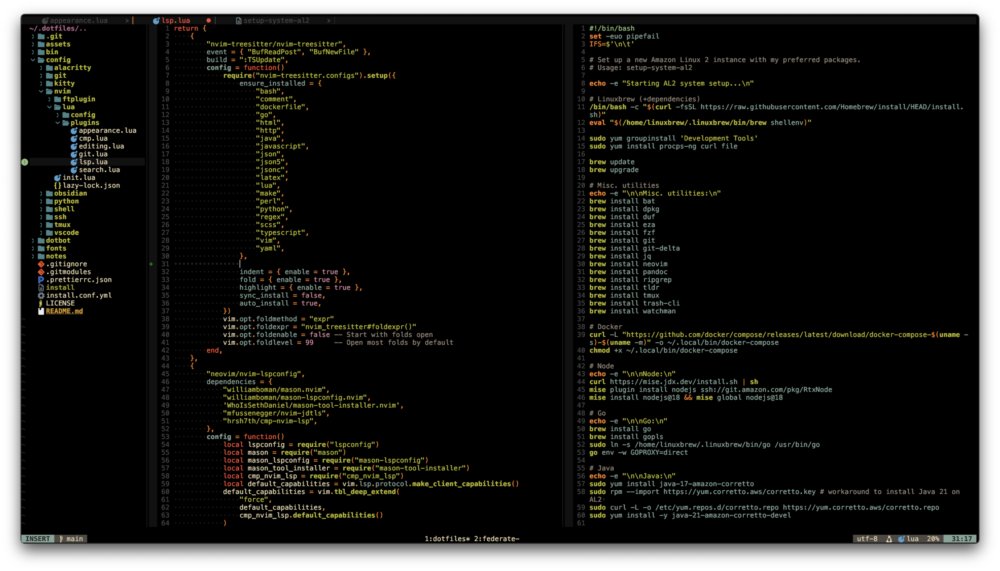
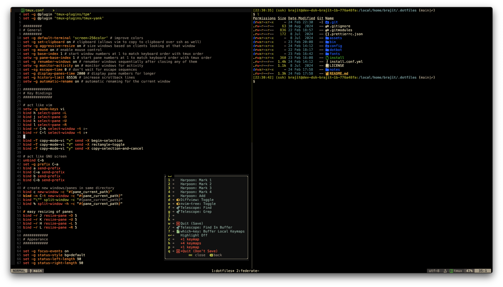

# Dotfiles

System setup and configuration for macOS and Amazon Linux. Symlinking to `$HOME` is managed by [Dotbot][dotbot].

## Setup

### 1. Homebrew (macOS only)

macOS has no `git` until the Xcode Command Line Tools are installed. The [Homebrew](https://brew.sh) installer installs them, so run it first:

```shell
/bin/bash -c "$(curl -fsSL https://raw.githubusercontent.com/Homebrew/install/HEAD/install.sh)"
echo 'eval "$(/opt/homebrew/bin/brew shellenv)"' >> ~/.zprofile
eval "$(/opt/homebrew/bin/brew shellenv)"
git --version
```

### 2. SSH keys

Press Enter at each `ssh-keygen` prompt to accept the defaults.

ed25519 (GitHub):

```shell
ssh-keygen -t ed25519 -C "rajitbanerjee15@gmail.com"
eval "$(ssh-agent -s)"
ssh-add ~/.ssh/id_ed25519
cat ~/.ssh/id_ed25519.pub
```

Copy the output and add it at https://github.com/settings/keys.

ecdsa (Amazon hosts; `mwinit` signs this key, so there is nothing to paste):

```shell
ssh-keygen -t ecdsa -C "brajit@amazon.com"
eval "$(ssh-agent -s)"
ssh-add ~/.ssh/id_ecdsa
```

### 3. Clone and install symlinks

Type `yes` if the clone asks to trust GitHub's host key.

```shell
# Work identity goes in ~/.gitconfig_local, which the dotfiles gitconfig includes
git config --global user.name "Rajit Banerjee"
git config --global user.email "brajit@amazon.com"
mv ~/.gitconfig ~/.gitconfig_local

git clone git@github.com:rajitbanerjee/dotfiles ~/.dotfiles
cd ~/.dotfiles && ./install
git config user.email "rajitbanerjee15@gmail.com"  # personal email for this repo only
exec $SHELL -l
```

`./install` is safe to rerun. Rerun it if an app (for example Ghostty) has written its own config over a linked file.

### 4. Install system packages

```shell
export WAKATIME_API_KEY=<key>  # optional: creates ~/.wakatime.cfg

# Amazon Linux
setup-system-al2023  # or setup-system-al2

# macOS (needs Homebrew from step 1)
setup-system-mac
install-mac-apps
```

The scripts continue past a failed step and list every failure at the end. Fix those, then rerun the script. Expect prompts for `sudo`, `mwinit`, and (on Amazon Linux) switching the default shell to zsh.

### 5. (Optional) Migrate zsh history

From your Mac, copy `.zsh_history` between Cloud Desktops:

```shell
scp brajit@<old-host>:~/.zsh_history ~/Desktop/ZSH_HISTORY
scp ~/Desktop/ZSH_HISTORY brajit@<new-host>:~/.zsh_history
```

## Screenshots





## License

[MIT][license]

[dotbot]: https://github.com/anishathalye/dotbot
[license]: LICENSE
